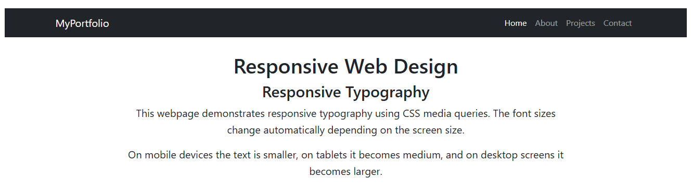
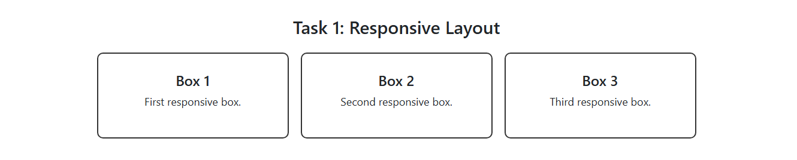
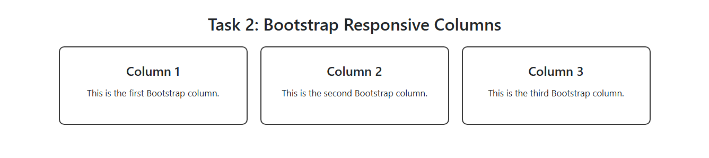
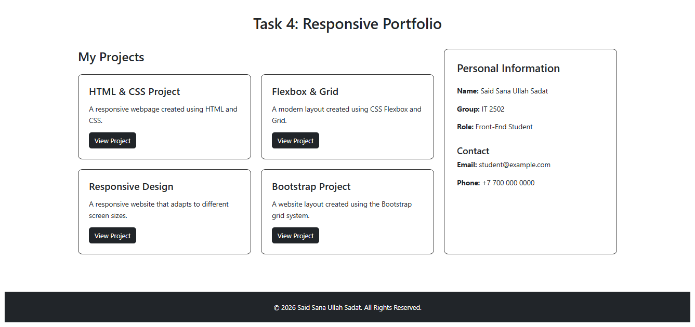

# Assignment #3 - Responsive Web Design

## Student Information

**Name:** Said Sana Ullah Sadat  
**Group:** IT 2502

---

# Part 1 - Media Queries

## Task 0 - Responsive Typography

In this task, I created a simple webpage with headings and paragraphs. I used CSS Media Queries to change the font sizes for different screen sizes.

The typography changes for:

- Desktop
- Tablet
- Mobile

### Screenshot

---

## Task 1 - Responsive Layout with Media Queries

In this task, I created three responsive boxes using CSS Flexbox and Media Queries.

On desktop, the three boxes are displayed in one row.

On tablet, two boxes are displayed in one row and the third box moves to the next row.

On mobile, all three boxes are displayed vertically.

Bootstrap was not used for this task.

### Screenshot

---

# Part 2 - Bootstrap Grid System

## Task 2 - Bootstrap Responsive Columns

In this task, I used the Bootstrap 12-column grid system to create three responsive columns.

The layout uses:

- `col-12` for mobile
- `col-md-6` for tablet
- `col-lg-4` for desktop

On large screens, each column takes 4 of the 12 grid columns.

### Screenshot

---

## Task 3 - Bootstrap Navigation Bar

In this task, I created a responsive Bootstrap navigation bar.

The navigation bar contains:

- MyPortfolio logo
- Home
- About
- Projects
- Contact

On smaller screens, the navigation links collapse into a hamburger menu.

### Screenshot

---

# Part 3 - Combined Project

## Task 4 - Responsive Portfolio Page

In this task, I created a complete responsive portfolio page using both Bootstrap Grid and CSS Media Queries.

The portfolio contains:

- Responsive Bootstrap navigation bar
- Portfolio project cards
- Personal information sidebar
- Contact information
- Responsive footer

Bootstrap Grid is used to arrange the projects and sidebar.

CSS Media Queries are used to adjust font sizes, spacing, and layout for different screen sizes.

### Screenshot

---

# Technologies Used

- HTML5
- CSS3
- CSS Media Queries
- Bootstrap 5.3
- Bootstrap Grid System
- Bootstrap Navbar
- Flexbox
- Responsive Web Design

---

# Summary

In this assignment, I created responsive web pages using CSS Media Queries and the Bootstrap Grid system. I practiced responsive typography, layouts, Bootstrap columns, responsive navigation, and a complete portfolio page. The project adapts to mobile, tablet, and desktop screen sizes.

---

# Conclusion

This assignment helped me understand how responsive websites adapt to different screen sizes. I learned how to use Media Queries and Bootstrap's 12-column grid to create flexible and responsive layouts.